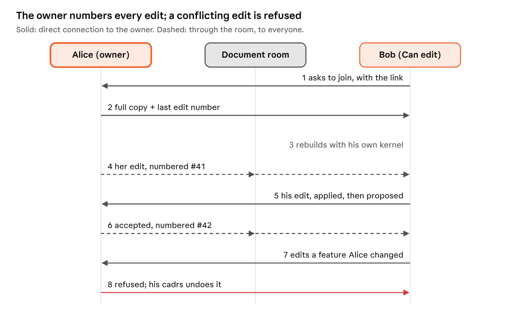

# Editing together

*Adapted from Gianluca Corsini's guide to cadrs
([#273](https://github.com/rvdende/cadrs/issues/273)).*

**There is no server.** The document owner's cadrs keeps the master copy and numbers every edit.
Everyone else edits a full copy of their own and proposes their edits to the owner's. Each person
also rebuilds the geometry on their own computer.

## Building blocks

- **Identity.** A person's cadrs ID is a public key. A data folder can hold several identities,
  each with its own key, switched from the account menu. One is in use at a time.
  **Preferences › Collaboration** shows it.
- **Connections.** cadrs connects with [iroh](https://www.iroh.computer/): encrypted QUIC
  connections opened by public key, direct where the network allows and otherwise through a
  relay that can't read the traffic. There are two channels: a direct connection to the owner (to
  join, propose edits and ask for sharing changes), and the document's *room*, which carries the
  numbered edits, who is there, and their pointers, to everyone.
- **Sharing.** By cadrs ID or by link, with **Can edit** or **Can view**, and rights for copying,
  exporting, sharing, commenting and linking. A link holds the document's ID, the room's secret
  and the owner's address, so holding it is enough to ask to join. Turning link sharing off moves
  the document to a new room, and old links stop working.

## Two people, step by step

Alice owns the document; Bob can edit.

*Proposals and the copy travel on a direct connection to the owner; numbered edits reach everyone
through the room.*

1. **Joining.** Bob opens the link. His cadrs contacts Alice's by her key, and hers checks his
   access and sends a full copy, including imported files, with the number of the last edit.
2. **Rebuilding.** Bob's cadrs rebuilds the parts with its own kernel. Both now have the document
   open, so both are in its room.
3. **Alice edits.** The change applies at once on her computer. Her cadrs numbers it and sends it
   to the room, with a checksum of the resulting document.
4. **Bob edits.** His change also applies at once, to his own copy. His cadrs proposes it to
   Alice's.
5. **Alice's cadrs decides.** If someone else changed the same thing since the edit Bob started
   from, it refuses, and Bob's cadrs takes the edit back with a message saying who got there
   first. Otherwise it numbers the edit and sends it to the room. "The same thing" is one feature,
   a tab's settings, or a whole tab, so two people can edit different features of one Part Studio
   at the same time.
6. **Staying in step.** If Bob's copy stops matching the checksum, or a numbered edit doesn't
   arrive, his cadrs fetches a fresh copy. Each person's undo undoes only their own edits.

## What else is shared

- **Presence:** everyone's avatar in the top bar, with **Follow** and **Go to their view**; their
  initials on the tabs and features they are in; their pointer, selection and camera, live.
  <kbd>Alt</kbd>+click sends everyone a "look here" ping.
- **Locks:** tabs that can't be merged edit by edit (Drawings, PCB Studios) are taken by one
  person at a time.
- **Comments and versions** are ordered by the owner's cadrs, like edits. Main is the shared
  workspace; switching to a branch makes your work private until you merge it.

## Who decides what

The owner's cadrs answers every request by itself, from the document's sharing list. Nobody has
to click Accept.

| Request | What the owner's cadrs does |
| --- | --- |
| Join | accepts it if the person is on the sharing list or holds a working link |
| Add a member, from someone allowed to share | accepts it, never with more access than that person's own |
| Leave the document | accepts it |
| Transfer ownership | accepts it if it comes from the current owner |

Only the owner can change permissions, remove members, turn link sharing on or off, and rename,
delete or transfer the document.

## When people leave

If the owner's cadrs goes away, the online editor with the lowest cadrs ID takes over ordering
the edits, and hands back when the owner returns. People who can only view are left read-only
while no editor is online. Edits kept that way reach the owner when that editor and the owner
are online together.
