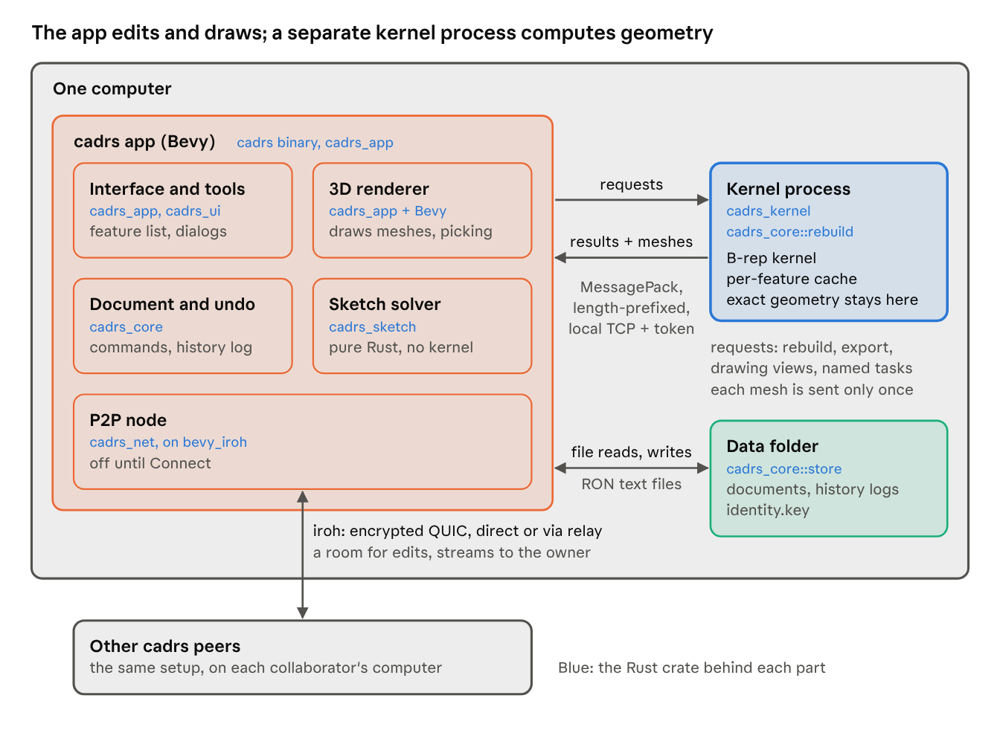

# How cadrs works

*The pages in this part are adapted from Gianluca Corsini's guide to cadrs
([#273](https://github.com/rvdende/cadrs/issues/273)). They are for the curious, and for people
who want to contribute: using cadrs doesn't need any of it.*

cadrs is one Rust program built on the Bevy engine, with its geometry kernel running in a second
process beside it. The app draws and edits; the kernel computes the parts.

*One cadrs installation. The kernel keeps the exact geometry; the app only ever sees display
meshes, and the P2P node is the only part that touches the network.*

- **The document model** (`cadrs_core`, no graphics). A document is a set of tabs: Part Studios
  with feature lists, Assemblies, Drawings, Variable Studios and PCB Studios. Every change is a
  command that goes through an undo history.
- **Storage.** Each document is a folder in the data folder, holding `document.ron`. Beside it,
  an append-only history log keeps every change as a delta, with a full copy every so often. A
  version is a named point in that log.
- **Rebuilding.** A Part Studio's parts are rebuilt from its feature list. Each feature's result
  is cached under a key made from every feature before it, so an edit recomputes only from the
  first feature that changed. Rebuilds use several processor cores, show parts as they come,
  and stop early when you edit again.
- **The kernel process.** cadrs's own pure-Rust B-rep kernel runs in a separate process, so a
  kernel crash costs one rebuild, not the app (`CADRS_KERNEL=thread` keeps it in the app, for
  debugging). The app sends requests (a rebuild, a STEP export, drawing views) over a local
  connection protected by a token. The exact geometry stays in the kernel; the app gets back
  display meshes with named faces, edges and vertices.
- **The app** (`cadrs_app`, on Bevy). The documents page, tabs, the 3D view, the sketcher (its
  constraint solver is pure Rust) and the dialogs. It turns clicks into commands, and shows the
  old parts until the rebuilt ones arrive.
- **The network** (`cadrs_net`). Editing together and public documents; see
  [Editing together](editing-together.md) and [Public documents](public-documents.md). cadrs
  stays offline until you connect, with the network button in the top bar, or every time it
  starts with **Preferences › Collaboration**.
- **Programs without a window.** The same executable also runs as a seed peer for public
  documents (`cadrs --public-seed`), lists the stored documents (`--list-documents`), and
  rebuilds one to report its errors (`--document <name> --check`). `cadrs --help` lists them all.

## The browser version

The browser version is the whole desktop app compiled to WebAssembly, running in a browser tab.

- **Drawing:** WebGPU where the browser has it, otherwise WebGL2.
- **Files:** an in-memory file tree that the browser saves in its own storage (IndexedDB), so
  documents survive closing the tab. Exports become downloads, and imports come from the
  browser's file picker.
- **The kernel:** a page has one thread, so the kernel runs inside the tab instead of in its own
  process. A heavy rebuild holds up the page while it runs.
- **The network:** a page can't open direct connections, so the browser version always connects
  through iroh's relays. It keeps its own cadrs ID in the browser's storage.
- **Left out:** the MCP server for AI assistants, updates, and SpaceMouse support.

Anyone can serve it: unpack the release's web archive (`cadrs-web.tar.gz`) and serve the folder
over HTTPS with any web server. Browsers enable WebGPU only on secure pages, with `localhost` as
the exception. Serving it only hands out the app: everything runs in each person's browser, and
their documents stay there.
